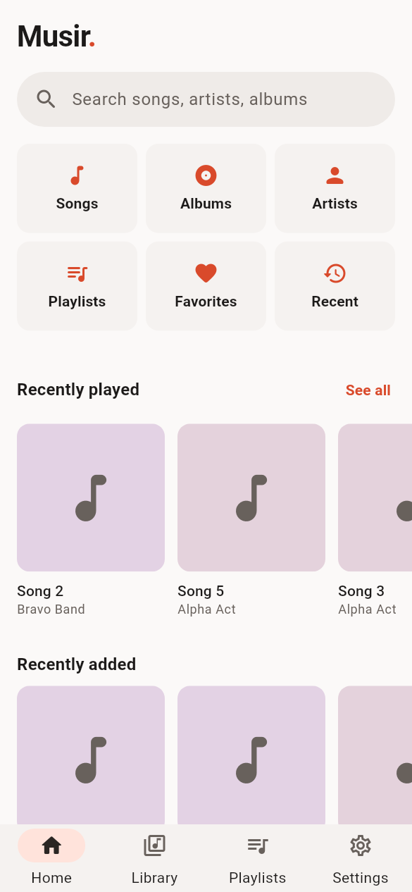
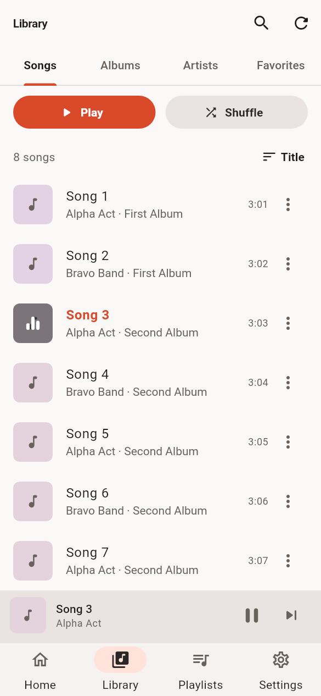
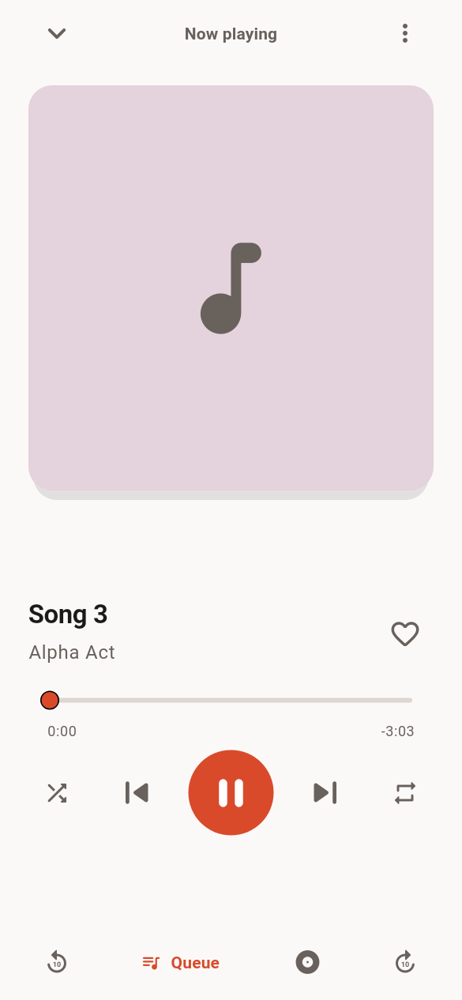
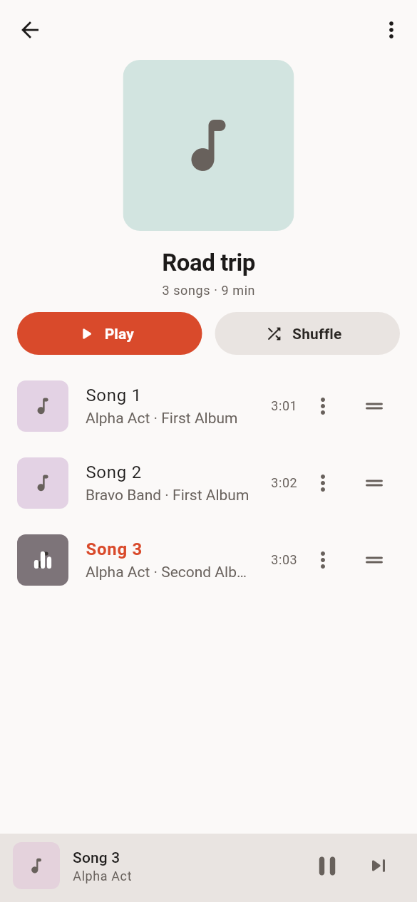
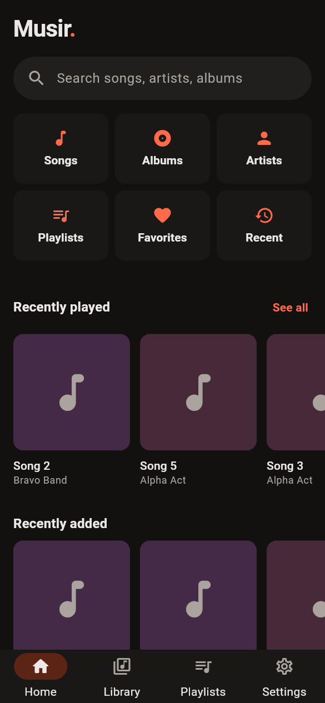
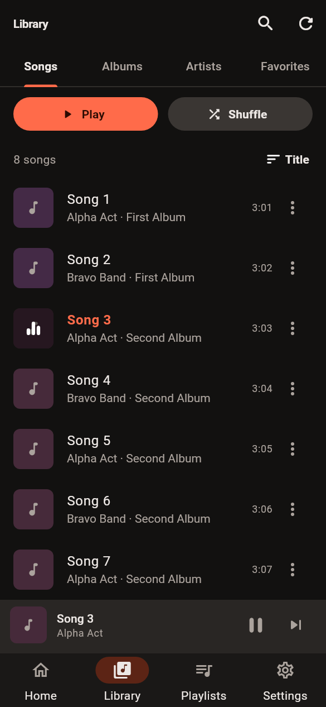
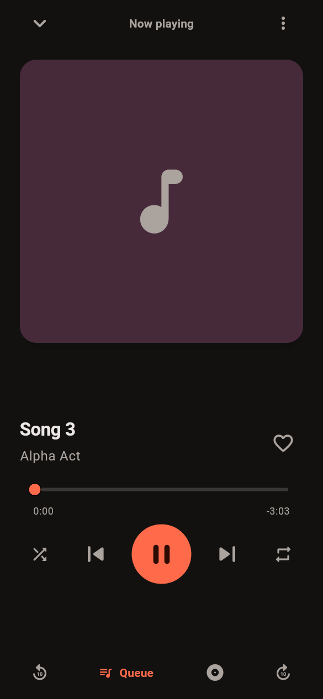
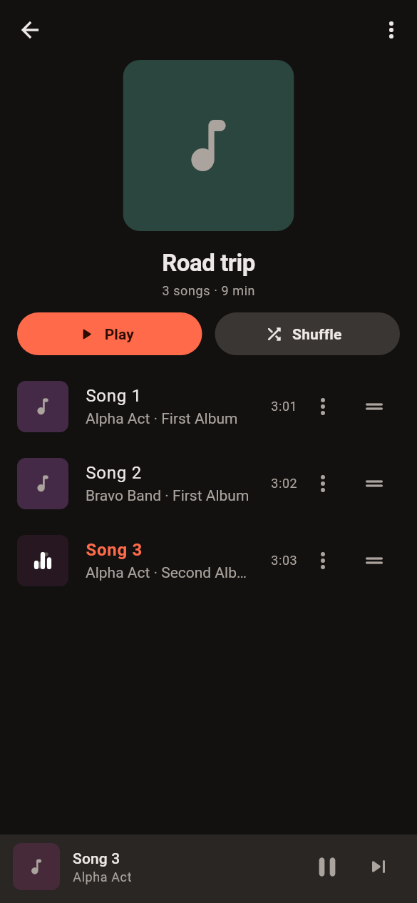

# Musir

A minimal, fast local music player for Android, built with Flutter.
Everything stays on your device: no accounts, ads, analytics or network access.

| Home | Library | Now Playing | Playlist |
|------|---------|-------------|----------|
|  |  |  |  |
|  |  |  |  |

> These images are **rendered by the widget-test harness** (real app code, real
> fonts, placeholder artwork), not captured on a device. Regenerate with
> `MUSIR_SCREENSHOTS=1 flutter test test/tool/screenshots_test.dart`.

## Features

- **Library**: scans device storage in a background isolate, reads tags and
  embedded artwork, handles missing metadata, hides duplicate files, rescans
  incrementally (only new/changed files are re-read).
- **Browse**: songs (sortable), albums, artists, favorites, recently played and
  recently added; debounced search over title, artist and album.
- **Now Playing**: large artwork, seek bar, previous/play/next, shuffle,
  repeat (off/all/one), ±10 s skip, favorite, queue (tap to jump, drag to
  reorder, swipe to remove), play next / add to queue, album and artist links.
- **Background playback**: media notification, lock-screen controls, headset
  and Bluetooth buttons through `just_audio_background`.
- **Playlists**: create, rename, delete (with Undo), add/remove, reorder, play,
  collage artwork, song count and total duration.
- **Favorites and history** persist locally (SQLite via Drift). The last queue
  and position are restored on launch (optional).
- **Settings**: theme (system/light/dark), default sort, rescan, resume last
  queue, skip silence, privacy and version info.
- Light and dark themes, system text scaling, semantic labels, 48 dp touch
  targets, haptics, and reduced-motion support for the player transition.

## Architecture

```
lib/
  app/        app root, router (go_router), shell, theme and design tokens, providers
  core/       shared widgets (track tile, artwork, empty state, library gate), utils
  data/       Drift database, repositories, plain models (Track, Playlist) and
              pure helpers (sort, search, dedupe, album/artist grouping)
  services/   audio engine interface + just_audio implementation, playback store,
              library scanner (isolate) and permission gateway
  features/   home, library, player, playlists, search, settings
```

Key decisions:

- **`PlaybackController` is plain Dart** and drives an `AudioEngine` interface.
  All queue, shuffle, repeat, restore and error-recovery logic is unit-tested
  against a fake engine; `JustAudioEngine` is a thin wrapper.
- **Shuffle physically reorders the queue** (current track first) instead of
  using the engine's hidden shuffle order, so the queue you see and reorder is
  the real play order. Turning shuffle off restores the original order.
- **Pure-Dart library scanner** (`audio_metadata_reader`) instead of a MediaStore
  plugin. `on_audio_query` was last published in 2023 and its forks are
  unproven; a pure-Dart scanner is testable on real files. It sits behind the
  `LibraryScanner` interface so a MediaStore implementation can replace it.
- Tracks are upserted by file path, so ids (and favorites, playlist entries and
  history that reference them) survive rescans. Files that disappear are removed
  via `ON DELETE CASCADE`, but **never when storage was unreadable**.
- Albums are grouped by album-artist tag, or by containing folder when absent,
  so a guest artist does not split an album.

## Setup

Requirements: Flutter 3.47.8 (Dart 3.13), JDK 17+, Android SDK.

```bash
flutter pub get
dart run build_runner build      # only after changing lib/data/db/database.dart
flutter run                      # on a connected Android device/emulator
```

Quality gate (same as CI): `./tool/check.sh` runs format, `flutter analyze`
(must report zero issues) and all tests.

## Build and release

```bash
flutter build apk --debug
flutter build apk --release      # build/app/outputs/flutter-apk/app-release.apk
flutter build appbundle          # Play Store
```

Release builds are signed with the debug key unless `android/key.properties`
exists. To sign properly:

1. `keytool -genkey -v -keystore ~/musir-upload.jks -keyalg RSA -keysize 2048 -validity 10000 -alias upload`
2. `cp android/key.properties.example android/key.properties` and fill it in
   (git-ignored; never commit keystores).
3. Build as above. Debug-signed builds must not be published.

CI (`.github/workflows/ci.yml`) runs analyze, tests and both APK builds and
uploads the APKs as an artifact.

## Permissions

| Permission | Why |
|---|---|
| `READ_MEDIA_AUDIO` (Android 13+) / `READ_EXTERNAL_STORAGE` (≤ 12) | read audio files to build the library |
| `FOREGROUND_SERVICE`, `FOREGROUND_SERVICE_MEDIA_PLAYBACK`, `WAKE_LOCK` | keep playing with the screen off |

Release builds request no `INTERNET` permission (debug/profile manifests add it
for Flutter tooling). This comes from reading the plugins' own manifests; confirm
it in the merged manifest of a real build.

## Dependencies

| Package | Role |
|---|---|
| `flutter_riverpod`, `go_router` | state and navigation |
| `just_audio`, `just_audio_background`, `audio_session` | playback, notification/lock screen/media buttons, audio focus |
| `audio_metadata_reader` | tags and embedded artwork (pure Dart) |
| `permission_handler`, `device_info_plus` | audio permission (API-level aware) |
| `drift`, `drift_flutter` | SQLite persistence |
| `shared_preferences` | settings and queue snapshot |
| `package_info_plus`, `path`, `path_provider` | app info and file paths |

`just_audio_background` is a beta release (0.0.1-beta.17) of a widely used
package; it wraps `audio_service`, so the two are not combined.

## Supported audio formats

The scanner looks for `.mp3 .m4a .aac .flac .wav .ogg .opus .oga .wma .m4b .amr .3gp .mka`.
Whether a file *plays* depends on the device's codecs (ExoPlayer). Files whose
tags cannot be read still appear, titled from the filename, and files that fail
to decode are skipped with a message.

**Tag reading was tested on generated MP3 and WAV files only.** M4A, FLAC, OGG
and Opus tag parsing relies on `audio_metadata_reader` and has not been run here
against real-world files.

## Testing

`flutter test` runs 120 tests:

- repositories against in-memory SQLite (cascades, rescans, ordering)
- sort/search/dedupe/grouping logic
- the scanner on generated audio files (tags, artwork, `.nomedia`, corrupt files)
- `PlaybackController` (queue edits, shuffle/repeat, completion, errors,
  missing files, persistence/restore) against a fake engine
- widget tests that boot the real app with fakes and drive permission, scan,
  playback, player, favorites, queue, search, playlists, settings and restore
  flows, plus a layout stress matrix (320 dp phone, 1.8x text, tablet; light and
  dark; very long metadata) that fails on any overflow

### Testing on a physical device

1. Enable USB debugging, connect the device, `flutter run --release`.
2. Grant the audio permission, wait for the scan, play a track.
3. Lock the screen: the notification and lock-screen controls should work.
4. Unplug or disconnect headphones: playback should pause.
5. Place a call or start another audio app: playback should pause and, where
   the other app releases focus, resume.

## Not verified yet

This project was developed in a sandbox **without an Android SDK** (the SDK
download host is blocked there), so the following have **not** been run:

- `flutter build apk` / `appbundle` (debug or release), including the Gradle
  signing config and manifest merging
- anything on a physical device or emulator: real playback, the media
  notification and lock-screen controls, Bluetooth/headset buttons, audio
  focus, call interruptions, headphone unplug
- direct-path file access under Android's scoped storage with only the audio
  permission, and scan time/memory on a large library (no profiling done)
- the mini-player to full-player transition and haptics on a real device
- the queue bottom sheet and other overlays in the rendered screenshots (their
  behavior is covered by widget tests, not by images)

Run CI (or `flutter build apk` locally) and the device checklist above before
relying on any of these.

## Troubleshooting

- **No music found**: check the audio permission in system settings, then use
  Library > rescan. Folders containing `.nomedia`, hidden folders, `Android/`,
  and Ringtones/Notifications/Alarms are skipped on purpose.
- **Permission screen keeps appearing**: if "Don't allow" was chosen twice
  Android stops prompting; use **Open settings** and enable *Music and audio*.
- **Playback stops in the background**: disable battery optimization for Musir;
  some vendors kill foreground services aggressively.
- **No media notification**: check Musir's notification settings in system
  settings. (How Android 13+ treats media notifications without the runtime
  notification permission was not verified.)
- **Build errors after changing the database**: run
  `dart run build_runner build`.
